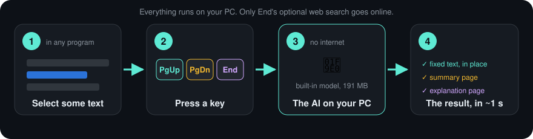
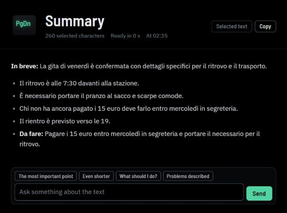
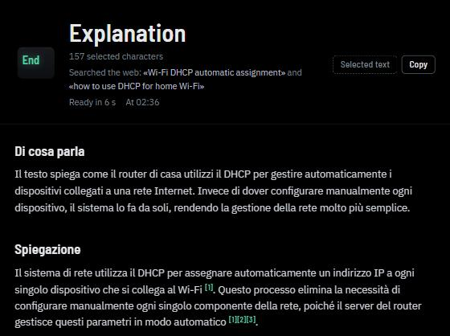
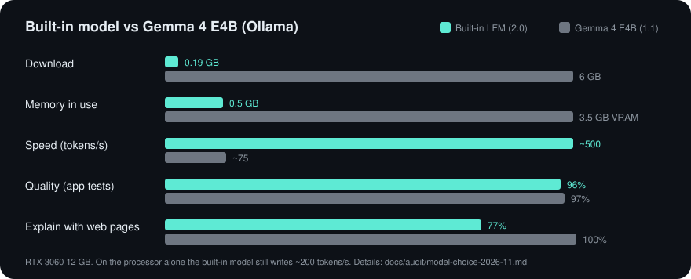
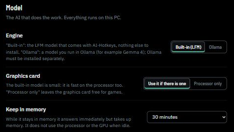

# AI-Hotkeys

**Select text anywhere in Windows, press one key, and a small AI on your PC fixes, summarizes or explains it.**
No account, no cloud, nothing else to install.

[](https://github.com/Jack8090-sudo/AI-Hotkeys/releases/latest)




## The three keys

| Key | What it does | Example |
|---|---|---|
| **PgUp** | **Fixes** spelling, grammar and accents, and translates English into Italian. In Notepad, Word, VS Code, Obsidian and Notepad++ it replaces the text in place. | `ho mandato il file a giulia ma nn so se l'a ricevuto` → `Ho mandato il file a Giulia, ma non so se l'ha ricevuto.` |
| **PgDn** | **Summarizes**: a short line plus the key points, with a **"Da fare"** line when the text asks you to do something. | A long email → *In breve* + 4 points + what you must do and by when |
| **End** | **Explains** in simple Italian, with the technical terms. If needed it **searches the web first** and cites its sources `[1] [2]`. | `DHCP`, an error message, a paragraph from a manual |

On the results page you can keep asking: *"What should I do?"*, *"Even shorter"*, *"A practical example"*, or your
own question.

<table>
<tr>
<td width="50%"></td>
<td width="50%"></td>
</tr>
<tr>
<td align="center"><b>PgDn</b>: summary</td>
<td align="center"><b>End</b>: explanation with web sources</td>
</tr>
</table>

<sub>Real outputs of the built-in model (version 2.0).</sub>

## Install (3 steps)

1. **Download** `AI-Hotkeys-Setup-<version>.exe` from the
   [latest release](https://github.com/Jack8090-sudo/AI-Hotkeys/releases/latest).
2. **Run it.** It is not code-signed, so SmartScreen may say "Windows protected your PC": choose
   **More info → Run anyway**. It installs into `%LOCALAPPDATA%\Programs\AI-Hotkeys`, a folder private to your
   account, with everything included: the AI model, its engine, Python and AutoHotkey.
3. **Use it.** The ✦ icon appears near the clock. Select some text and press **PgUp**, **PgDn** or **End**.

Full guide: [docs/INSTALL.md](docs/INSTALL.md) · Guida in italiano: [docs/guide-it.md](docs/guide-it.md)

## Requirements

| | |
|---|---|
| 💻 System | Windows 10 or 11, 64-bit |
| 💾 Disk | about 400 MB |
| 🧠 Memory | about 0.5 GB while the model is loaded (it unloads itself after 30 minutes without use) |
| 🎮 Graphics card | **not needed**. With one (NVIDIA, AMD or Intel) answers are about twice as fast |
| 🌐 Internet | only for End's optional web search |

## Small and fast: the built-in model

AI-Hotkeys 2.0 brings its own model: [LFM2.5-230M](https://huggingface.co/LiquidAI/LFM2.5-230M), trained
further on thousands of examples of exactly these three tasks and run by
[llama.cpp](https://github.com/ggml-org/llama.cpp). Version 1.1 needed Ollama and the 6 GB Gemma 4 model instead.



- **Where it is as good as Gemma:** fixing, summaries, web search words, short explanations.
- **Where Gemma is still better:** explanations built on long web pages; the small model sometimes repeats a
  line or slips on a detail. Once in a while a fix can even drop a word that matters (a slangy `nn` = "non"):
  give a corrected text a quick look before sending it.
- **Want Gemma anyway?** Install [Ollama](https://ollama.com/download), then switch **Settings → Model → Engine →
  Ollama**. Details and numbers: [docs/audit/model-choice-2026-11.md](docs/audit/model-choice-2026-11.md).

## Settings

Right-click the ✦ icon → **Settings**: keys, theme, answer length, web search and the AI engine. Changes apply
at once.



Every option, also the ones that are only in `config.ini`: [docs/CONFIGURATION.md](docs/CONFIGURATION.md).

<details>
<summary><b>Tray menu</b></summary>

| Item | What it does |
|---|---|
| Settings | keys, theme, answer length, web search, engine |
| Free VRAM | unloads the model at once (handy before gaming); the next key loads it again |
| Open SearXNG in browser | the private search engine used by End |
| Edit prompts | your own prompts (`prompts_user.py`), never overwritten by updates |
| Open config.ini / Open folder | the settings file / the install folder |
| Reload / Exit | restarts / closes AI-Hotkeys (asks first if the AI is working) |

</details>

<details>
<summary><b>Good to know</b></summary>

- **Nothing selected?** The key does its normal job (page up, page down, end of line) and your clipboard is left
  alone. In consoles and on AI-Hotkeys' own pages the keys always act normally.
- **Cancel** a running job: hold **Esc** for 2 seconds.
- **PgUp checks before pasting**: same window, same selection. If something changed, it pastes nothing and
  shows the result on the results page instead.
- **Web search (End)**: with "When needed" the AI decides if a search helps (technical terms, errors, names),
  not for personal notes. Search words go to public search engines through your local SearXNG; your full
  text never leaves the PC. Turn it off in Settings.
- **The results page** closes after about 4 minutes without use and cannot be reloaded with F5: press the key
  again.

</details>

<details>
<summary><b>When something goes wrong</b></summary>

Errors appear as a small toast near the mouse; the keys keep working.

| Message | What to do |
|---|---|
| The AI engine is not responding | try again; if it repeats, read `work\llama-server.log`. With graphics-driver problems choose **Graphics card → Processor only** |
| Port 8095 is used by another program | set another `llama_port` in `config.ini` |
| The AI engine / model is missing | an antivirus may have removed a file: run the Setup again |
| The selected text is too long | select a shorter part |
| The answer was cut off | nothing was pasted; select less text |

More: [docs/TROUBLESHOOTING.md](docs/TROUBLESHOOTING.md).

</details>

<details>
<summary><b>Upgrading from 1.x</b></summary>

- **From 1.1 (Ollama + Gemma):** after the upgrade AI-Hotkeys uses the built-in model, because a 1.1
  `config.ini` names no engine. To keep Gemma, set **Settings → Model → Engine → Ollama** (or `backend = ollama`
  under `[qwen]`). Ollama itself is no longer needed otherwise.
- **From 1.0 (installed in `C:\AI-Hotkeys`):** run the new Setup; it offers to move your settings to the new
  private folder. See [Migration from v1.0.0](docs/INSTALL.md#migration-from-v100).

</details>

<details>
<summary><b>Run from source (developers)</b></summary>

- **Python 3.13 x64** and **AutoHotkey v2.0** (the project pins 2.0.19).
- The engine and the model are not in git: `llama\` (llama-server and its DLLs, llama.cpp release pinned in
  `build\pins.json`) and `models\lfm-hotkeys-Q6_K.gguf`. The build puts them in `build\out\payload\app\llama`
  and `\models`: copy them into your checkout, or set `backend = ollama`.

```
git clone https://github.com/Jack8090-sudo/AI-Hotkeys.git
cd AI-Hotkeys
copy config.example.ini config.ini
```

Then start `main.ahk` with AutoHotkey v2. It uses `python\pythonw.exe` when that folder exists, otherwise the
`pythonw` on your PATH, always with `-E -s`. Web search needs the SearXNG runtime, also built by
`powershell -NoProfile -ExecutionPolicy Bypass -File build\build.ps1 -SkipInstaller`. Tests, build and CI:
[CONTRIBUTING.md](CONTRIBUTING.md) · code map: [docs/CODEMAPS/INDEX.md](docs/CODEMAPS/INDEX.md).

</details>

## Privacy, security, licenses

- 🔒 [PRIVACY.md](PRIVACY.md): your text stays on your PC; only End's search words go online, and only if you
  leave web search on.
- 🛡️ [SECURITY.md](SECURITY.md): local pages protected by a token, the AI engine listens only on `127.0.0.1`,
  and how to report a vulnerability.
- 📜 AI-Hotkeys is MIT licensed ([LICENSE](LICENSE)). The installer also ships the AI model (LFM Open License
  v1.0, modified), llama.cpp (MIT), Python, AutoHotkey (GPL-2.0), SearXNG (AGPL-3.0) and other libraries, each
  under its own license: [THIRD_PARTY_NOTICES.md](THIRD_PARTY_NOTICES.md) and [`licenses/`](licenses). The
  source archives of AutoHotkey, SearXNG and lxml/libiconv are attached to every release.

Version: [`VERSION`](VERSION) · changes: [CHANGELOG.md](CHANGELOG.md)
